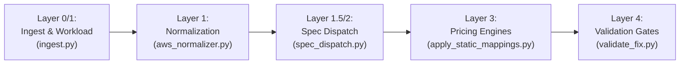

# Master Cloud Cost & Cross-Cloud Migration Curriculum (AWS → GCP)

> **Purpose:** This curriculum is designed to make you an elite Cross-Cloud Cost & Migration Architect.  
> It separates what you can learn **for free using general AI (ChatGPT / Claude)** from what is **proprietary to our system (`cur-web-AGY`)** which you should ask **Antigravity (Me)**.

---

## Navigation & Study Structure

```
                  ┌───────────────────────────────────────────────┐
                  │          THE TWO HALVES OF EXPERTISE          │
                  └───────────────────────┬───────────────────────┘
                                          │
            ┌─────────────────────────────┴─────────────────────────────┐
            ▼                                                           ▼
┌───────────────────────┐                                   ┌───────────────────────┐
│   [GPT] PUBLIC AI     │                                   │ [CODEBASE] ANTIGRAVITY│
│ Cloud Architecture &  │                                   │ cur-web-AGY Pipeline, │
│ Billing Fundamentals  │                                   │ Code, Specs & Corpus  │
└───────────────────────┘                                   └───────────────────────┘
```

Every module contains:
1. **The Core Concepts**: AWS service mechanics vs GCP counterpart mechanics.
2. **The 4-Decision Mapping Strategy**: How our system classifies it (`SKU`, `FORMULA`, `PASS`, `IGNORE`).
3. **The Migration Traps**: Real financial blowups (2x to 50x errors) that happen if mapped incorrectly.
4. **[GPT] Prompt**: Ready-to-use prompt you can paste into ChatGPT to master the public cloud side.
5. **[ME] Questions**: Specific questions to ask Antigravity about how our codebase handles it.

---

## The 4 Mapping Decisions (Taxonomy)

In our engine (`cur-web-AGY`), every AWS line item resolves to one of four auditable decisions:

| Decision | Meaning | When to Use | Code / Rule Example |
|---|---|---|---|
| **SKU** | Deterministic 1:1 GCP SKU lookup with quantity multiplier | Exact functional and billing unit match exists | EBS gp3 → `Hyperdisk Balanced / pd-balanced` |
| **FORMULA** | Derived conversion math from extracted specs | The architecture translates, but the billing units differ | Redshift node-hours → BigQuery slot-hours; EC2 instance-hours → vCPU + RAM breakdown |
| **PASS** | Passthrough AWS cost, but assign correct GCP target label | Proprietary feature, incompatible billing unit, or platform-specific service | DynamoDB RCU/WCU; Private Link / VPC Endpoints |
| **IGNORE** | Project $0 with an explicit, auditable reason | AWS charges for something that is free or bundled on GCP | CloudWatch DashboardHour ($0 in GCP); EBS gp3 IOPS (included in base) |

---

# MODULE 1: Compute (EC2 vs Compute Engine)

### 1. Architectural & Billing Comparison
- **AWS EC2**:
  - Billed as single bundled hourly rate (includes vCPU, RAM, network bandwidth allowance, instance storage if NVMe, and base OS).
  - Families: General (`m5/m6i/m7i`, `m6g/m7g` Graviton ARM), Compute (`c5/c6i/c7i`, `c6g/c7g`), Memory (`r5/r6i/r7i`, `r6g/r7g`), Burstable (`t3/t4g`), Accelerated (`g4dn/g5/g6`, `p3/p4/p5`), Storage-optimized (`i3en/d2`).
  - Tenancy: Shared tenancy vs Dedicated Instance vs Dedicated Host.
  - OS Licensing: Windows, RHEL, and SLES have license premiums baked into the hourly instance rate.
- **GCP Compute Engine (GCE)**:
  - **Unbundled Billing**: GCP separates **Core (vCPU)** and **Memory (RAM)** into two separate SKUs for almost every instance type!
  - Machine Series:
    - *General Purpose*: `N4`, `N2`, `N2D` (AMD), `E2` (cost-optimized, cost-effective burstable).
    - *Compute-Optimized*: `C4`, `C4D`, `C3`, `C2`.
    - *Memory-Optimized*: `M3`, `M2`, `X4`.
    - *ARM-based*: `C4A` (Axion), `T2A` (Tau ARM).
    - *Accelerators*: Attached GPUs (T4, L4, A100, H100) are billed as independent resource line items.
  - **Custom Machine Types**: GCP allows arbitrary vCPU:RAM ratios on `N1`, `N2`, `N2D`, `E2`, whereas AWS forces rigid predetermined T-shirt sizes.

### 2. How `cur-web-AGY` Maps It
- **Code Reference**: `scripts/family_mapper.py`, `scripts/classify_mechanics.py`, `data/service_specs.json`.
- **Strategy**: `FORMULA` + `SKU`.
- **Logic**:
  1. Parse AWS `instance_type` (e.g. `c6i.4xlarge` → 16 vCPU, 32 GB RAM, Intel x86).
  2. Map AWS family prefix to target GCP family:
     - `c6i/c7i` → `C4` or `C4D` (modern default) or `C2`.
     - `m6i/m7i` → `N4` or `N4D` or `N2`.
     - `r6i/r7i` → `N4` High-Mem or `N2` High-Mem.
     - `t3/t4g` → `E2` (Standard or Burstable).
     - `c6g/m6g` (Graviton ARM) → `C4A` or `T2A` (with `"Arm"` infix in GCP SKU description).
     - GPU instances (`g4dn`, `g5`) → Compute Engine base VM + explicit GPU SKU (`nvidia-tesla-t4`, `nvidia-l4`).
  3. Emit 2 line items: `Compute Engine - Core` and `Compute Engine - RAM` multiplied by instance-hours.

### 3. Critical Traps & Gotchas
- **The Spot 10x Explosion Trap**: If an AWS bill has Spot EC2 instances (paid at 80% discount), projecting them against GCP On-Demand list prices produces an 8x–10x false inflation! Spot must map to GCP Spot/Preemptible SKUs.
- **Burstable CPU Credits Trap**: AWS charges `CPUCredits:vCPU-Hours` for `t3/t4g` bursting. GCP `E2` has no CPU credit fees (bursting is dynamic and built-in). These AWS credit rows must be mapped to **IGNORE ($0)**.
- **OS Premium Separation**: If Windows or RHEL is in `c.product` or `usage_type`, you must project GCP Windows/RHEL license SKUs, not just the raw hardware cores.

---

### 4. [GPT] Prompt (Copy-Paste to ChatGPT)
```text
Act as a Principal Cloud Infrastructure Architect. Teach me the deep architectural and cost differences between AWS EC2 and GCP Compute Engine:
1. Explain how EC2 instance families (c6i, m6i, r6i, t4g, g5) translate to GCP machine series (C4, N4, E2, C4A Axion, G2 with L4).
2. Compare the billing models: Why does GCP bill vCPU and RAM as separate SKUs while AWS bundles them into a single hourly rate?
3. How do burstable instances differ? (AWS t3/t4g CPU credits and T-family unlimited vs GCP E2 resource sharing).
4. How does Spot instance pricing, interruption, and SLA work on AWS vs GCP Spot VMs?
5. How is OS licensing (Windows Server, Red Hat Enterprise Linux) billed on AWS EC2 vs GCP GCE?
Provide clear, concrete examples with math showing how a c6i.2xlarge translates into GCP vCPU and RAM charges.
```

### 5. [ME] Questions (Ask Antigravity in this chat)
- *"Show me `scripts/family_mapper.py` and explain how our code extracts vCPU/RAM and chooses between N4, N4D, and C4."*
- *"Why did we fix the ARM infix bug for Graviton instances in our codebase?"*
- *"How does `cur-web-AGY` handle EC2 Spot rows across our 75 historical job databases?"*

---

# MODULE 2: Block Storage & Object Storage

### 1. Architectural & Billing Comparison
- **Block Storage (EBS vs GCP Persistent Disk / Hyperdisk)**:
  - **AWS EBS**:
    - `gp2`: Bundled baseline IOPS (3 IOPS/GB) up to burst, IOPS not separately billed.
    - `gp3`: Unbundled. Base 3,000 IOPS and 125 MB/s free. Additional IOPS (`IOPS-Mo`) and throughput (`MBps-Mo`) billed separately.
    - `io1 / io2 / io2 Block Express`: High-performance SAN, explicitly bills capacity ($/GB-mo) + provisioned IOPS ($/IOPS-mo).
    - `st1 / sc1`: HDD throughput/cold storage.
    - `Snapshots`: Incremental block storage billed in S3.
  - **GCP Persistent Disk (PD) & Hyperdisk**:
    - `pd-standard` (HDD), `pd-balanced` (cost-optimized SSD), `pd-ssd` (high performance SSD), `pd-extreme` (custom IOPS).
    - `Hyperdisk Balanced`: Dynamic IOPS & throughput provisioning.
    - `Hyperdisk Throughput / Extreme`.
    - `PD Snapshots`: Standard snapshot storage.
- **Object Storage (S3 vs Google Cloud Storage - GCS)**:
  - **AWS S3**:
    - Classes: `Standard`, `Intelligent-Tiering`, `Standard-IA` (30-day min), `One Zone-IA` (30-day min), `Glacier Instant Retrieval` (90-day min), `Glacier Flexible Retrieval` (90-day min), `Glacier Deep Archive` (180-day min).
    - Operations: Billed per **1,000 requests** (Tier 1: PUT/COPY/POST; Tier 2: GET/SELECT).
    - Retrieval fees: Per GB retrieved on IA/Glacier tiers.
    - Monitoring fee: Per 1,000 objects in Intelligent-Tiering.
  - **GCP Cloud Storage (GCS)**:
    - Classes: `Standard`, `Nearline` (30-day min), `Coldline` (90-day min), `Archive` (365-day min), `Autoclass` (automatic tiering).
    - Operations: Billed per **10,000 requests** (**Class A** vs **Class B**). Notice the **10x quantum difference**!
    - Autoclass has **no monitoring fee per object**!

### 2. How `cur-web-AGY` Maps It
- **Code Reference**: `scripts/apply_static_mappings.py`, `scripts/spec_dispatch.py`, `data/service_specs.json`.
- **EBS Mapping**:
  - `gp2` / `gp3` Capacity → `pd-balanced` or `Hyperdisk Balanced` (`SKU`, ratio ≈ 0.91x).
  - `gp3` Provisioned IOPS → **`IGNORE` ($0)** because `pd-balanced` bundles baseline performance.
  - `io1` / `io2` Capacity → `pd-extreme` (`SKU`).
  - `io1` / `io2` Provisioned IOPS → `pd-extreme IOPS` (`SKU`) — must NOT be ignored!
  - `EBS Snapshots` → `Compute Engine PD Snapshots` (`SKU`).
- **S3 Mapping**:
  - `S3 Standard` → `GCS Standard Storage` (`SKU`).
  - `S3 Standard-IA` → `GCS Nearline Storage` (`SKU`).
  - `S3 Glacier Flexible` → `GCS Coldline Storage` (`SKU`, pinned SKU to prevent 120x word-overlap bug).
  - `S3 Glacier Deep Archive` → `GCS Archive Storage` (`SKU`).
  - `S3 Requests (GET/PUT)` → **`PASS`** (because 1k vs 10k request quantum models cause math blowups).
  - `S3 Intelligent-Tiering Monitoring` → **`IGNORE` ($0)** because GCP Autoclass has no monitoring fee!

### 3. Critical Traps & Gotchas
- **The 10x Request Mismatch**: If you try to map AWS S3 PUT requests ($/1k) directly to GCP Class A ($/10k) using raw units, you project either 10x too high or 10x too low unless you divide/multiply by 10. `PASS` protects against this.
- **The Glacier 120x Word-Overlap Bug**: If matching on `"Glacier"` matches GCP `"Archive"` without checking duration, or pulls multi-region archive retrieval, rates explode.
- **EBS io2 vs gp3 Confusion**: gp3 IOPS are ignored because GCP balanced disks don't charge for low IOPS; but if you ignore io2 IOPS, you wipe out thousands of dollars of database I/O spend!

---

### 4. [GPT] Prompt (Copy-Paste to ChatGPT)
```text
Act as a Cloud Storage and FinOps Specialist. Explain the architectural and billing mechanics of AWS storage vs GCP storage:
1. Deep-dive into AWS EBS (gp2, gp3, io2, snapshots) vs GCP Persistent Disk (pd-standard, pd-balanced, pd-ssd, pd-extreme) and Hyperdisk.
2. How do IOPS and throughput charges differ between AWS gp3/io2 and GCP pd-balanced/Hyperdisk? Why is gp3 provisioned IOPS often considered bundled in GCP?
3. Compare AWS S3 vs Google Cloud Storage (GCS) storage classes and minimum retention periods (Standard, Nearline, Coldline, Archive vs S3 Standard, IA, Glacier).
4. Explain the operation cost models: AWS per-1,000 requests (PUT/GET) vs GCP per-10,000 requests (Class A vs Class B). What math trap happens when translating S3 API costs to GCS?
5. How does AWS S3 Intelligent-Tiering compare to GCP Autoclass in terms of transition fees and monitoring fees?
```

### 5. [ME] Questions (Ask Antigravity in this chat)
- *"Show me the exact lines in `apply_static_mappings.py` where EBS gp3 capacity and gp3 IOPS are processed."*
- *"Why did S3 Glacier have a 120x bug in earlier versions of our codebase, and how did our pinned SKU fix solve it?"*
- *"How does `spec_dispatch.py` prevent peripheral EBS and S3 transfer rows from being swallowed by core compute?"*

---

# MODULE 3: Managed Databases & Caching

### 1. Architectural & Billing Comparison
- **Relational Databases (RDS & Aurora vs Cloud SQL & AlloyDB)**:
  - **AWS RDS**:
    - Engines: PostgreSQL, MySQL, MariaDB, Oracle, SQL Server.
    - Billing: Instance-hours (Single-AZ vs Multi-AZ doubles the instance cost), Provisioned gp2/gp3/io1 storage, backup storage.
  - **AWS Aurora**:
    - Decoupled storage engine (distributed shared log storage across 3 AZs with 6-way replication).
    - Capacity: ACUs (Aurora Serverless v2: `ACU-Hour`, where 1 ACU = 2 vCPU + 4 GB RAM).
    - **I/O Requests**: Aurora Standard bills $0.20 per million I/O requests (`Aurora:StorageIOUsage`). Aurora I/O-Optimized bundles I/O into a higher instance/storage rate.
  - **GCP Cloud SQL**:
    - Engines: PostgreSQL, MySQL, SQL Server.
    - Billing: vCPU + RAM billed as custom components (High-Availability doubles vCPU/RAM and storage), SSD storage, storage autoscaling, automatic daily backup included up to retention.
    - **NO I/O charge**! Cloud SQL does not bill per I/O request.
  - **GCP AlloyDB**: PostgreSQL-compatible with decoupled compute/storage, comparable to Aurora architecture.
- **In-Memory Caching (ElastiCache vs Memorystore)**:
  - **AWS ElastiCache**: Redis / Memcached node-hours (e.g. `cache.r6g.xlarge`).
  - **GCP Memorystore**: Redis / Memcached billed per **GiB-hour** of provisioned cache capacity (Standard tier has automated failover replica).

### 2. How `cur-web-AGY` Maps It
- **Code Reference**: `scripts/apply_static_mappings.py`, `scripts/classify_mechanics.py`.
- **RDS Instance-Hours**: `SKU` / `FORMULA` → Cloud SQL custom vCPU + RAM SKUs.
- **RDS Storage**: `SKU` → Cloud SQL SSD storage SKU.
- **Aurora Serverless v2**: `FORMULA` → 1 ACU = 2 vCPU + 4 GB RAM → Cloud SQL custom SKUs.
- **Aurora I/O Requests**: **`PASS`** (or `IGNORE` with notes).
- **ElastiCache**: `FORMULA` → Extract RAM from cache node size (e.g. `cache.m5.large` = 6.38 GiB) → Memorystore GiB-hours.

### 3. Critical Traps & Gotchas
- **The Aurora 1300x I/O Inflation Bug**: In an early pipeline version, millions of Aurora I/O requests were mistakenly classified as storage volume (GB-Mo) instead of request counts. Projecting 500 million I/O requests as 500 million GB-Mo inflated a $100 charge into a $130,000 monthly bill! It is now strictly protected.
- **Multi-AZ Doubling**: RDS Multi-AZ instances must map to Cloud SQL High Availability (HA) configurations.

---

### 4. [GPT] Prompt (Copy-Paste to ChatGPT)
```text
Act as a Principal Database Reliability and Cloud Cost Engineer. Detail the differences between AWS relational databases and GCP managed databases:
1. Compare AWS RDS (Postgres/MySQL) architecture and billing with GCP Cloud SQL (Enterprise vs Enterprise Plus).
2. Contrast AWS Aurora's decoupled storage architecture (and its I/O charge per 1M requests) with GCP Cloud SQL and GCP AlloyDB.
3. How is Aurora Serverless v2 priced using ACUs (Aurora Capacity Units), and how do you mathematically translate ACUs into Cloud SQL or AlloyDB vCPU/RAM specs?
4. Compare AWS ElastiCache (Redis/Memcached instance node-hours) with GCP Memorystore (per GiB-hour capacity pricing). Show how to convert cache.r6g.xlarge to Memorystore.
5. What are the high-availability (Multi-AZ) cost implications on AWS vs GCP?
```

### 5. [ME] Questions (Ask Antigravity in this chat)
- *"Show me how `cur-web-AGY` extracts RAM for ElastiCache nodes to price Memorystore GiB-hours."*
- *"Where is the guardrail against Aurora I/O inflating database costs located in our repository?"*

---

# MODULE 4: Containers & Serverless

### 1. Architectural & Billing Comparison
- **Serverless Containers (Fargate vs Cloud Run & GKE Autopilot)**:
  - **AWS Fargate**:
    - Bills `vCPU-Hours` and `GB-Hours` independently per pod/task.
    - Supports x86 and Graviton (ARM) architectures.
    - Zero cluster management fee.
  - **GCP GKE Autopilot**:
    - Bills pod resource requests: Pod vCPU (`mCPU`), Pod Memory (`GiB`), and Pod Ephemeral Storage.
    - Cluster management fee is waived for the first cluster or billed under GKE standard rules.
  - **GCP Cloud Run**:
    - Serverless container execution.
    - Billed on **vCPU-seconds**, **Memory GiB-seconds**, and **Request count**.
    - Request concurrency: Multiple concurrent requests can share a single container instance (lowers cost dramatically).
- **Managed Kubernetes (EKS vs GKE Standard)**:
  - **AWS EKS**: Cluster management fee of $0.10/hour ($73/month) per cluster + underlying EC2 worker nodes.
  - **GCP GKE Standard**: Cluster management fee of $0.10/hour ($73/month) per cluster (first zonal cluster free per billing account) + underlying GCE worker nodes.
- **Function as a Service (AWS Lambda vs Cloud Run Functions)**:
  - **AWS Lambda**:
    - Billed as **GB-Seconds**: Memory size allocated (MB) × execution duration (ms).
    - **CPU is bundled and locked to memory**: 1 vCPU is allocated per 1,769 MB of RAM.
    - Requests: $0.20 per 1M requests.
  - **GCP Cloud Run Functions (formerly Cloud Functions 2nd gen)**:
    - Built directly on top of Cloud Run!
    - **vCPU and Memory are billed on separate SKUs**: You pay for vCPU-seconds and memory GiB-seconds independently.
    - Requests: $0.40 per 1M requests (with generous free tier).

### 2. How `cur-web-AGY` Maps It
- **Fargate**: `SKU` → GKE Autopilot Pod vCPU (`4A90-D02B-3BAC`) and Autopilot Pod Memory Requests.
- **EKS Fee**: `SKU` → GKE Cluster Management Fee ($0.10/hr, exact 1:1 match).
- **ECS Management**: **`IGNORE` ($0)** — ECS control plane has no hourly fee.
- **Lambda**: `FORMULA` → Cloud Run memory GiB-sec (1.0x) + vCPU-sec (using the 1 vCPU : 1,769 MB ratio, ~0.5x).

---

### 3. [GPT] Prompt (Copy-Paste to ChatGPT)
```text
Act as a Serverless and Kubernetes Cost Architect. Compare AWS and GCP container and serverless platforms:
1. Compare AWS Fargate pricing (vCPU-hours + GB-hours) with GCP GKE Autopilot (Pod CPU/Memory requests) and GCP Cloud Run.
2. Explain the billing structure of AWS EKS vs GCP GKE Standard: cluster management fee, multi-cluster management, and worker node pricing.
3. Compare AWS Lambda billing with GCP Cloud Run Functions:
   - Why does Lambda bundle vCPU into GB-seconds (1 vCPU = 1,769 MB)?
   - Why does GCP Cloud Run bill vCPU-seconds and Memory GiB-seconds on separate SKUs?
   - How does concurrency in Cloud Run affect cost compared to Lambda's single-request-per-instance model?
```

### 4. [ME] Questions (Ask Antigravity in this chat)
- *"Show me how our pipeline maps AWS Fargate rows to GKE Autopilot SKUs and why Autopilot rates must be prefetched."*
- *"Where is the Lambda formula mapping in `cur-web-AGY`, and how is the 0.5x ratio derived?"*

---

# MODULE 5: Networking & Data Transfer (The Sneaky 15%)

### 1. Architectural & Billing Comparison
- **NAT Gateway (AWS NAT Gateway vs GCP Cloud NAT)**:
  - **AWS NAT Gateway**:
    - Charges **$0.045/hour per gateway** deployed (~$32.40/month per AZ).
    - PLUS **$0.045/GB data processing charge** for every byte flowing through.
  - **GCP Cloud NAT**:
    - Software-defined, distributed NAT (no bottleneck VMs).
    - Charges an hourly rate **per VM utilizing the NAT**, NOT per gateway!
    - PLUS data processing rate ($0.045/GB down to $0.02/GB with volume).
    - *The Trap*: If a customer has 500 VMs behind 1 Cloud NAT, GCP Cloud NAT charges for 500 VM-hours! If they have 2 VMs, it costs almost nothing.
- **Internet Egress**:
  - **AWS**: Tiered egress pricing based on volume (First 10TB at $0.09/GB, Next 40TB at $0.085/GB, etc.).
  - **GCP**:
    - **Premium Tier** (uses Google's private global fiber backbone to exit at the POP closest to the user): $0.12/GB down to $0.08/GB.
    - **Standard Tier** (exits at the POP closest to the GCP region into public transit): $0.085/GB.
- **Inter-AZ / Inter-Zone Egress**:
  - **AWS**: Cross-AZ traffic is billed at **$0.01/GB in each direction** ($0.02/GB total round-trip).
  - **GCP**: Inter-zone egress within the same region is billed at **$0.01/GB**.
- **Private Endpoints & Interconnect**:
  - AWS VPC Endpoints (PrivateLink) vs GCP Private Service Connect (PSC).
  - AWS Transit Gateway (TGW) vs GCP Network Connectivity Center (NCC) / VPC Peering.
  - AWS Direct Connect vs GCP Dedicated/Partner Interconnect.

### 2. How `cur-web-AGY` Maps It
- **Code Reference**: `scripts/egress_rates.py`, `scripts/apply_static_mappings.py`.
- **Egress**: `SKU` → Evaluated by regional destination using `egress_rates.py` (Premium Tier default).
- **NAT Data Processing**: `SKU` → Cloud NAT Data Processing $/GB (exact match).
- **NAT Gateway-Hours**: Flagged for formula/assumptions (either 32-VM baseline assumption or passthrough).
- **Public IPv4**: `SKU` → GCP External Static IP charge ($0.005/hr).

---

### 3. [GPT] Prompt (Copy-Paste to ChatGPT)
```text
Act as a Cloud Networking and FinOps Specialist. Explain the architectural and billing nuances of AWS networking vs GCP networking:
1. Explain AWS NAT Gateway billing ($/hour + $/GB processed) vs GCP Cloud NAT billing (hourly fee per VM using NAT vs $/GB processed). Why does direct 1:1 translation fail?
2. Compare AWS Internet Egress with GCP Network Service Tiers (Premium Tier vs Standard Tier). How does Google's private fiber network affect pricing?
3. How does cross-Availability-Zone data transfer cost work on AWS (both directions) vs inter-zone data transfer on GCP?
4. Compare AWS Transit Gateway (TGW) and VPC Endpoints (PrivateLink) with GCP Network Connectivity Center (NCC) and Private Service Connect (PSC).
```

### 4. [ME] Questions (Ask Antigravity in this chat)
- *"How does `egress_rates.py` in `cur-web-AGY` handle cross-region and internet data transfer?"*
- *"Why is NAT Gateway-Hour under-projected when mapped 1:1, and how do we resolve it?"*

---

# MODULE 6: Analytics, Streaming & Big Data

| AWS Service | Billing Dimension | GCP Counterpart | GCP Billing Dimension | Mapping Strategy |
|---|---|---|---|---|
| **Redshift** | Node-hours (`ra3.4xlarge`, `dc2.large`) + Managed Storage | **BigQuery** | Active Storage + Slot-Hours / Editions | `FORMULA` (`_REDSHIFT_SLOT_MAP`) + `SKU` (BQ Active Storage) |
| **Athena** | $5.00 per TB scanned | **BigQuery On-Demand** | $6.25 per TB analysis | `SKU` |
| **EMR** | EC2 instance-hours + EMR fee per vCPU | **Dataproc** | GCE instance-hours + Dataproc fee ($0.01/vCPU-hr) | `FORMULA` |
| **Kinesis Data Streams** | Shard-hours ($0.015/hr) + PUT payload units | **Pub/Sub** | Volume throughput ($40/TB, no reservation) | `PASS` (shards) / `SKU` (volume) |
| **AWS Glue** | DPU-Hours ($0.44/DPU-hr) | **Cloud Dataflow** | Dataflow Workers (vCPU + RAM + Persistent Disk) | `PASS` |
| **Amazon MSK** (Kafka) | Broker instance-hours + storage | **Self-hosted Kafka on GCE** or Managed Kafka | GCE Broker VMs + PD Storage | `FORMULA` (footprint extraction) |

---

### [GPT] Prompt (Copy-Paste to ChatGPT)
```text
Act as a Big Data & Analytics Cloud Architect. Contrast the architecture and cost mechanics between AWS and GCP analytics:
1. Compare AWS Redshift (provisioned RA3 nodes with managed storage vs Serverless) with Google BigQuery (On-Demand $/TB scanned vs Editions Slot-commitments).
2. Compare Amazon Athena ($5/TB scanned) with BigQuery on-demand analysis ($6.25/TB scanned).
3. Contrast AWS EMR with Google Cloud Dataproc: how do their compute surcharges on top of base VMs compare?
4. Compare AWS Kinesis Data Streams (provisioned shard-hours vs on-demand) with Google Cloud Pub/Sub (serverless volume-based pricing). Why are shard-hours incompatible with Pub/Sub?
5. How does AWS MSK (Managed Streaming for Apache Kafka) translate to GCP?
```

---

# MODULE 7: Security, Observability & Governance

| Service Domain | AWS Service & Billing | GCP Counterpart & Billing | Mapping Decision | Why / Nuance |
|---|---|---|---|---|
| **Dashboards** | CloudWatch `DashboardHour` ($3.00/dashboard/mo) | **Cloud Monitoring Dashboards** ($0.00 FREE) | **`IGNORE` ($0)** | GCP does not charge for creating or viewing dashboards. |
| **Alarms** | CloudWatch Metric Alarms ($0.10/alarm/mo) | **Cloud Monitoring Alerting** ($0.00 FREE) | **`IGNORE` ($0)** / `PASS` | GCP alerting policies are free. |
| **Audit Logs** | CloudTrail (Management events 1st trail free; Data events $0.10/100k) | **Cloud Audit Logs** (Admin activity free; Data access paid) | **`IGNORE` ($0)** for free management events | Both provide free baseline management audit logging. |
| **Encryption Keys** | AWS KMS ($1.00/key/mo + $0.03/10k crypto requests) | **Cloud KMS** ($1.00/key-version/mo + $0.03/10k operations) | **`SKU`** | **Exact 1:1 functional & billing parity!** High row-count win. |
| **Secret Storage** | Secrets Manager ($0.40/secret/mo + $0.05/10k calls) | **Secret Manager** ($0.06/active version/mo + $0.03/10k calls) | **`SKU`** | Secret storage on GCP is ~85% cheaper. |
| **WAF / DDoS** | AWS WAF (WebACL $5/mo, Rule $1/mo, Requests $0.60/M) | **Cloud Armor** (Policy $5/mo, Rule $1/mo, Requests $0.75/M) | **`FORMULA`** | Component pricing matches 1:1; easily calculated. |

---

# MODULE 8: Commitments, Discounts & FinOps (The Reviewer's Test)

### 1. Structural Difference Between AWS & GCP Discounts
- **AWS Commitments**:
  - **Savings Plans (SP)**: Spend commitment ($/hr) applied across Compute (EC2, Fargate, Lambda) or EC2 Instance. Attached directly to eligible usage lines in CUR.
  - **Reserved Instances (RI)**: Capacity/rate reservation for specific instance types in specific regions/AZs.
- **GCP Commitments**:
  - **Committed Use Discounts (CUDs)**:
    - *Resource-based CUDs*: Commit to specific vCPU and RAM quantities in a specific region (1-yr or 3-yr) for up to 57% off.
    - *Spend-based CUDs*: Commit to spending a minimum dollar amount per hour on a service (e.g. Cloud SQL, Spanner) for up to 52% off.
  - **Sustained Use Discounts (SUDs)**: Automatic discount (up to 30%) applied when a VM runs for a significant portion of a billing month, **with ZERO upfront commitment**.

### 2. The Core FinOps Rule in `cur-web-AGY`
> **"Never compare a discounted AWS price to a list GCP price."**  
> If an enterprise AWS bill has a 3-year all-upfront Savings Plan giving 60% off, comparing that to GCP On-Demand list prices will falsely make GCP look 2x more expensive!  
> **Our Rule**: We extract `pricing/publicOnDemandCost` from the AWS bill to compare **On-Demand AWS vs On-Demand GCP** as the fair baseline, and present CUDs as an optimization tier.

---

### [GPT] Prompt (Copy-Paste to ChatGPT)
```text
Act as a FinOps Certified Practitioner. Explain commitment and discount structures across AWS and GCP:
1. Explain AWS Savings Plans (Compute vs EC2) and Reserved Instances (Standard vs Convertible). How do they attach to billing lines?
2. Detail GCP Committed Use Discounts (Resource-based CUDs vs Spend-based CUDs). How do they work for Compute Engine vs Cloud SQL?
3. What are GCP Sustained Use Discounts (SUDs), and how do they apply automatically without commitment?
4. Why is comparing an AWS discounted amortized bill directly against GCP On-Demand list prices a fatal FinOps flaw? How should an enterprise migration business case present On-Demand vs Committed scenarios?
```

---

# MODULE 9: The `cur-web-AGY` Pipeline Architecture

To master our product, you must know how data flows through the 4 layers:



1. **Layer 0/1 (`scripts/ingest.py`)**:
   - Parses CSV/Parquet/Excel/PDF bills into DuckDB (`aws_li_catalog`).
   - Filters out non-workload items (Tax, Support, Credits, Refunds, EDP/Marketplace) using `data/workload_classification.json`.
2. **Layer 1 (`scripts/aws_normalizer.py`)**:
   - Normalizes messy AWS product strings to canonical keys (`ec2`, `rds`, `s3`, `opensearch`, `lambda`, `kms`).
   - Uses descending length alias matching and regex word boundaries (`\b`) to avoid substring collisions (e.g. matching `ec2` inside `ec2 container registry`).
3. **Layer 1.5 & 2 (`scripts/spec_dispatch.py` & `data/service_specs.json`)**:
   - Routes rows based on service-scoped charge types (e.g. splitting `opensearch` into `data_transfer`, `block_storage`, and `compute`).
   - Routes unmatched rows to `misc` with strict confidence caps (`llm_guidance.py`).
4. **Layer 3 (`scripts/apply_static_mappings.py`, `family_mapper.py`, `egress_rates.py`)**:
   - Applies the 4 decisions (`SKU`, `FORMULA`, `PASS`, `IGNORE`).
   - Calculates projected costs and writes to `aws_li_to_gcp_li` and `gcp_projection`.
5. **Layer 4 (`scripts/validate_fix.py`)**:
   - Runs deterministic safety gates: `unreachable_rate`, `null_gcp_service`, `passthrough_budget`, and `detect_outliers.py` (A1 outlier detection).
   - Autofixes (such as echo-clearing and map-no-rate downgrades) execute before gates.

---

## 4-Week Study Schedule

| Week | Target Focus | Free AI (ChatGPT) Learning Goal | Antigravity (Me) Codebase Goal |
|---|---|---|---|
| **Week 1** | **Compute & Commitments** | Master EC2 vs GCE machine types, vCPU/RAM billing, Spot VMs, and SP/RI vs CUD/SUD. | Trace `family_mapper.py` and inspect how our pipeline resolves Graviton and Spot instances. |
| **Week 2** | **Storage & Databases** | Master EBS vs PD/Hyperdisk, S3 vs GCS (1k vs 10k requests), RDS/Aurora vs Cloud SQL/AlloyDB. | Inspect `apply_static_mappings.py`, check gp3 vs io2 IOPS rules, and verify the S3/Glacier pinned SKUs. |
| **Week 3** | **Containers, Serverless & Networking** | Master Fargate vs Autopilot/Cloud Run, Lambda vs Cloud Run Functions, NAT Gateway vs Cloud NAT, and Egress. | Review `egress_rates.py`, Fargate SKU loading in `prefetch_skus.py`, and the NAT Gateway VM assumption. |
| **Week 4** | **Analytics, Security & Pipeline Mastery** | Master Redshift vs BigQuery, Athena, KMS parity, CloudWatch $0 rules, and FinOps framing. | Read `data/service_specs.json` and `data/pricing_matrix.json` end-to-end; run `validate_fix.py` on test jobs. |
