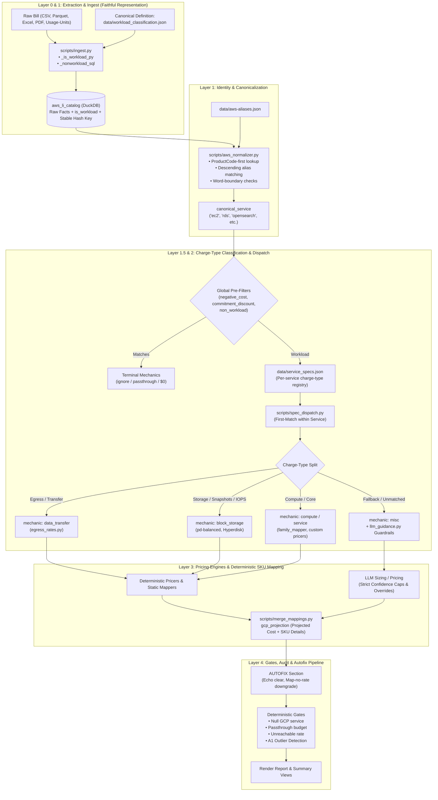

# Target Pipeline Architecture: AWS-to-GCP Cost Projection

This document specifies the end-to-end targeted architecture of the AWS-to-GCP cost projection pipeline, covering data extraction, identity normalization, spec-driven charge-type dispatch, deterministic pricing engines, and Layer-4 validation gates.

---

## 1. High-Level Architecture Diagram

---

## 2. Layer-by-Layer Specifications

### Layer 0 & 1: Ingestion & Workload Classification
- **Primary Source**: `scripts/ingest.py`
- **Configuration Contract**: `data/workload_classification.json`
- **Output Artifact**: `aws_li_catalog` table inside `projection.duckdb`
- **Key Principles**:
  - **Single Source of Truth**: Evaluates authoritative AWS `LineItemType` (`Usage`, `DiscountedUsage`, `SavingsPlanCoveredUsage`) alongside lowercase non-workload patterns (Credit, Refund, Tax, Marketplace, Support, Savings Plan, Late Fee, etc.).
  - **Predicate Unification**: Unified between SQL query building (`_nonworkload_sql`) and row-by-row parsing (`_is_workload_py`).
  - **Faithfulness Invariant**: Total gross and amortized costs must strictly reconcile to the source bill invoice; no fabricated data or default sizes are added at the extraction layer.

---

### Layer 1: Identity Normalization
- **Primary Source**: `scripts/aws_normalizer.py`
- **Configuration Contract**: `data/aws-aliases.json`
- **Key Principles**:
  - **ProductCode-First**: Authoritative AWS codes (e.g. `AmazonEC2` → `ec2`, `AmazonES` → `opensearch`, `AmazonRDS` → `rds`) supersede ambiguous textual descriptions.
  - **Alias Priority**: Fallback alias matching is sorted descending by length to ensure specific products win over shorter generic substrings.
  - **Word Boundaries**: Short aliases (<=4 characters, such as `ec2`, `s3`, `waf`, `ebs`) require regex word-boundary checks (`\b`) to prevent false positive substring collisions.

---

### Layer 1.5 & 2: Spec-Driven Dispatch & Splitting
- **Primary Sources**: `scripts/spec_dispatch.py`, `data/service_specs.json`, `docs/SERVICE_SPECS_DESIGN.md`
- **Key Principles**:
  - **Per-Service Registry**: Replaces the legacy global regex chain with service-scoped charge-types evaluated first-match-wins *within* the service.
  - **Greedy Rule Splitting**: Service rules do not swallow peripheral charges. For example, `opensearch` yields data transfer rows to `data_transfer` and storage/snapshots to `block_storage`, reserving `opensearch` exclusively for core instance-hours.
  - **Global Pre-Filters**: Universal exclusions (`negative_cost`, `commitment_discount`, `non_workload`) run prior to per-service dispatch.
  - **Guided Misc Fallback**: When an unrecognized row drops to `misc`, `scripts/llm_guidance.py` applies deterministic guardrails and confidence caps from `data/llm_guardrails.json`.

---

### Layer 3: Deterministic Pricing & SKU Mapping
- **Primary Sources**: `scripts/family_mapper.py`, `scripts/apply_static_mappings.py`, `scripts/egress_rates.py`
- **Decision Taxonomy**:
  - **SKU**: Deterministic 1:1 GCP SKU mapping (e.g. EBS gp3 to `Hyperdisk Balanced / pd-balanced`, external static IPs, GCS storage classes).
  - **FORMULA**: Derived conversion equations (e.g. EC2 vCPU+RAM breakdown, Redshift node-hours to BigQuery slots, Dataproc vCPU multipliers).
  - **PASS**: Passthrough at AWS cost with appropriate GCP label (e.g. DynamoDB, private endpoint fees, specialty services).
  - **IGNORE**: Explicit $0 cost with auditable justification (e.g. CPU credits, free-tier logging/monitoring).

---

### Layer 4: Autofix, Gates, & Audit Verification
- **Primary Sources**: `scripts/validate_fix.py`, `scripts/outlier_gate.py`
- **Execution Order**:
  1. **Autofixes**: Run *first* to normalize minor discrepancies (e.g., clearing GCP service echo anomalies, downgrading unresolvable SKU attempts to passthrough).
  2. **Audit Gates**: Run *second* as pure assertion checks on the post-fix state (`null_gcp_service`, `passthrough_budget`, `unreachable_rate`, `A1 Outlier Gate`).
- **Auditability**: Produces structured inspection outputs and reports verifying end-to-end catalog reconciliation and pricing accuracy.
